# 画面: /login.xhtml

- ファイル: `src/main/webapp/login.xhtml`
- 使用 Bean:
  - `loginBean` → com.example.app.web.LoginBean（@SessionScoped）

## 呼び出しフロー

メソッド式と、下流（Service/Mapper）の呼び出しがあるプロパティのみ図示しています。全参照は下の表を参照してください。

```mermaid
flowchart LR
    n0[["/login.xhtml"]]
    n1("LoginBean.login()")
    n2["AuthService.authenticate()"]
    n3{{"UserMapper.selectByLoginId"}}
    n4[("users")]
    n0 -->|"action"| n1
    n1 --> n2
    n2 --> n3
    n3 -->|"R"| n4
    classDef screen fill:#dbeafe,stroke:#1d4ed8,color:#1e3a8a
    classDef partial fill:#f1f5f9,stroke:#64748b,color:#334155
    classDef bean fill:#dcfce7,stroke:#15803d,color:#14532d
    classDef service fill:#fef9c3,stroke:#a16207,color:#713f12
    classDef mapper fill:#fae8ff,stroke:#a21caf,color:#701a75
    classDef table fill:#ffedd5,stroke:#c2410c,color:#7c2d12
    classDef ng fill:#fee2e2,stroke:#b91c1c,color:#7f1d1d,stroke-dasharray:4 2
    class n0 screen
    class n1 bean
    class n2 service
    class n3 mapper
    class n4 table
```



## 呼び出しパス一覧

| 定義ファイル:行 | タグ@属性 | EL式 | Bean#メソッド | Service | Mapper#メソッド | SQL | テーブル | 備考 |
|---|---|---|---|---|---|---|---|---|
| src/main/webapp/login.xhtml:8 | h:inputText@value | `#{loginBean.loginId}` | LoginBean#getLoginId |  |  |  |  |  |
| src/main/webapp/login.xhtml:9 | h:inputSecret@value | `#{loginBean.password}` | LoginBean#getPassword |  |  |  |  |  |
| src/main/webapp/login.xhtml:10 | h:commandButton@action | `#{loginBean.login}` | LoginBean#login | AuthService#authenticate | UserMapper#selectByLoginId | select | users |  |

## 使用 SQL

### UserMapper#selectByLoginId（select）

- 定義元: `src/main/resources/com/example/app/mapper/UserMapper.xml:25`
- テーブル: users

```sql
SELECT u.id, u.login_id, u.name, u.email, u.department_id FROM users u WHERE u.login_id = #{loginId}
```
