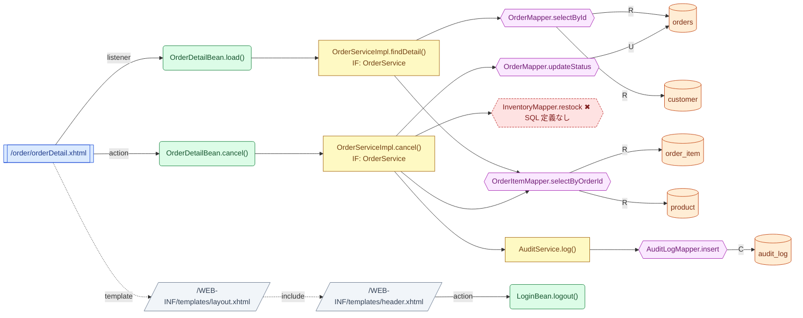

# 画面: /order/orderDetail.xhtml

- ファイル: `src/main/webapp/order/orderDetail.xhtml`
- テンプレート / インクルード:
  - template: `src/main/webapp/WEB-INF/templates/layout.xhtml`（`src/main/webapp/order/orderDetail.xhtml` から）
  - include: `src/main/webapp/WEB-INF/templates/header.xhtml`（`src/main/webapp/WEB-INF/templates/layout.xhtml` から）
- 使用 Bean:
  - `orderDetailBean` → com.example.app.web.OrderDetailBean（@RequestScoped）
  - `loginBean` → com.example.app.web.LoginBean（@SessionScoped）

## 呼び出しフロー

メソッド式と、下流（Service/Mapper）の呼び出しがあるプロパティのみ図示しています。全参照は下の表を参照してください。



## 呼び出しパス一覧

| 定義ファイル:行 | タグ@属性 | EL式 | Bean#メソッド | Service | Mapper#メソッド | SQL | テーブル | 備考 |
|---|---|---|---|---|---|---|---|---|
| src/main/webapp/order/orderDetail.xhtml:9 | f:viewParam@value | `#{orderDetailBean.orderId}` | OrderDetailBean#getOrderId |  |  |  |  |  |
| src/main/webapp/order/orderDetail.xhtml:10 | f:event@listener | `#{orderDetailBean.load}` | OrderDetailBean#load | OrderServiceImpl#findDetail（IF: OrderService） | OrderMapper#selectById | select | orders, customer |  |
| src/main/webapp/order/orderDetail.xhtml:10 | f:event@listener | `#{orderDetailBean.load}` | OrderDetailBean#load | OrderServiceImpl#findDetail（IF: OrderService） | OrderItemMapper#selectByOrderId | select | order_item, product |  |
| src/main/webapp/order/orderDetail.xhtml:13 | h:outputText@value | `#{orderDetailBean.order.orderNo}` | OrderDetailBean#getOrder |  |  |  |  |  |
| src/main/webapp/order/orderDetail.xhtml:14 | ui:repeat@value | `#{orderDetailBean.order.items}` | OrderDetailBean#getOrder |  |  |  |  |  |
| src/main/webapp/order/orderDetail.xhtml:17 | h:commandButton@action | `#{orderDetailBean.cancel}` | OrderDetailBean#cancel | OrderServiceImpl#cancel（IF: OrderService） | OrderItemMapper#selectByOrderId | select | order_item, product |  |
| src/main/webapp/order/orderDetail.xhtml:17 | h:commandButton@action | `#{orderDetailBean.cancel}` | OrderDetailBean#cancel | OrderServiceImpl#cancel（IF: OrderService） | InventoryMapper#restock |  |  | SQL 定義なし |
| src/main/webapp/order/orderDetail.xhtml:17 | h:commandButton@action | `#{orderDetailBean.cancel}` | OrderDetailBean#cancel | OrderServiceImpl#cancel（IF: OrderService） | OrderMapper#updateStatus | update | orders |  |
| src/main/webapp/order/orderDetail.xhtml:17 | h:commandButton@action | `#{orderDetailBean.cancel}` | OrderDetailBean#cancel | OrderServiceImpl#cancel（IF: OrderService） → AuditService#log | AuditLogMapper#insert | insert | audit_log |  |
| src/main/webapp/order/orderDetail.xhtml:18 | h:commandButton@rendered | `#{orderDetailBean.order.status ne 'CANCELLED'}` | OrderDetailBean#getOrder |  |  |  |  |  |
| src/main/webapp/WEB-INF/templates/header.xhtml:4 | h:form@rendered | `#{loginBean.loggedIn}` | LoginBean#isLoggedIn |  |  |  |  |  |
| src/main/webapp/WEB-INF/templates/header.xhtml:5 | (テキスト) | `#{loginBean.userName}` | LoginBean#getUserName |  |  |  |  |  |
| src/main/webapp/WEB-INF/templates/header.xhtml:6 | h:commandLink@action | `#{loginBean.logout}` | LoginBean#logout |  |  |  |  |  |

## 使用 SQL

### OrderMapper#selectById（select）

- 定義元: `src/main/resources/com/example/app/mapper/OrderMapper.xml:38`
- テーブル: orders, customer

```sql
SELECT o.id, o.order_no, o.customer_id, c.name AS customer_name, o.order_date, o.status, o.total_amount FROM orders o INNER JOIN customer c ON c.id = o.customer_id WHERE o.id = #{id}
```

### OrderItemMapper#selectByOrderId（select）

- 定義元: `src/main/java/com/example/app/mapper/OrderItemMapper.java:15 @Select`
- テーブル: order_item, product

```sql
SELECT i.id, i.order_id, i.product_id, p.name AS product_name, i.quantity, i.unit_price FROM order_item i INNER JOIN product p ON p.id = i.product_id WHERE i.order_id = #{orderId} ORDER BY i.id
```

### OrderMapper#updateStatus（update）

- 定義元: `src/main/resources/com/example/app/mapper/OrderMapper.xml:43`
- テーブル: orders

```sql
UPDATE orders SET status = #{status}, updated_at = CURRENT_TIMESTAMP WHERE id = #{id}
```

### AuditLogMapper#insert（insert）

- 定義元: `src/main/java/com/example/app/mapper/AuditLogMapper.java:10 @Insert`
- テーブル: audit_log

```sql
INSERT INTO audit_log (operator, action, target_id, created_at) VALUES (#{operator}, #{action}, #{targetId}, CURRENT_TIMESTAMP)
```

## 未解決・要確認

- **Mapper: SQL未定義** `InventoryMapper#restock` に SQL 定義がありません
