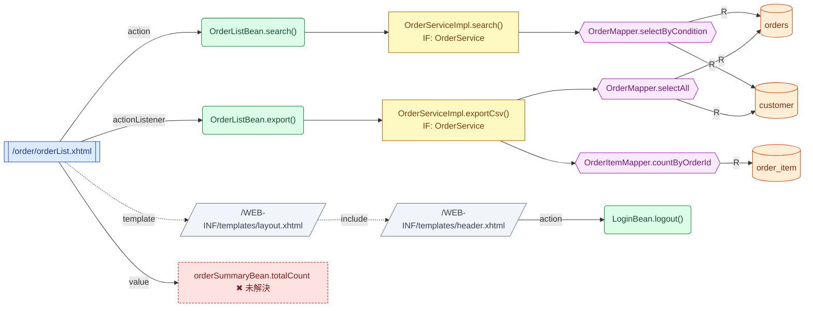

# 画面: /order/orderList.xhtml

- ファイル: `src/main/webapp/order/orderList.xhtml`
- テンプレート / インクルード:
  - template: `src/main/webapp/WEB-INF/templates/layout.xhtml`（`src/main/webapp/order/orderList.xhtml` から）
  - include: `src/main/webapp/WEB-INF/templates/header.xhtml`（`src/main/webapp/WEB-INF/templates/layout.xhtml` から）
- 使用 Bean:
  - `orderListBean` → com.example.app.web.OrderListBean（@ViewScoped）
  - `loginBean` → com.example.app.web.LoginBean（@SessionScoped）

## 呼び出しフロー

メソッド式と、下流（Service/Mapper）の呼び出しがあるプロパティのみ図示しています。全参照は下の表を参照してください。



## 呼び出しパス一覧

| 定義ファイル:行 | タグ@属性 | EL式 | Bean#メソッド | Service | Mapper#メソッド | SQL | テーブル | 備考 |
|---|---|---|---|---|---|---|---|---|
| src/main/webapp/order/orderList.xhtml:9 | h:inputText@value | `#{orderListBean.condition.orderNo}` | OrderListBean#getCondition |  |  |  |  |  |
| src/main/webapp/order/orderList.xhtml:10 | h:inputText@value | `#{orderListBean.condition.customerName}` | OrderListBean#getCondition |  |  |  |  |  |
| src/main/webapp/order/orderList.xhtml:11 | h:commandButton@action | `#{orderListBean.search()}` | OrderListBean#search | OrderServiceImpl#search（IF: OrderService） | OrderMapper#selectByCondition | select | orders, customer |  |
| src/main/webapp/order/orderList.xhtml:12 | h:commandButton@actionListener | `#{orderListBean.export}` | OrderListBean#export | OrderServiceImpl#exportCsv（IF: OrderService） | OrderMapper#selectAll | select | orders, customer |  |
| src/main/webapp/order/orderList.xhtml:12 | h:commandButton@actionListener | `#{orderListBean.export}` | OrderListBean#export | OrderServiceImpl#exportCsv（IF: OrderService） | OrderItemMapper#countByOrderId | select | order_item |  |
| src/main/webapp/order/orderList.xhtml:13 | h:dataTable@value | `#{orderListBean.orders}` | OrderListBean#getOrders |  |  |  |  |  |
| src/main/webapp/order/orderList.xhtml:22 | h:outputText@value | `#{orderSummaryBean.totalCount}` |  |  |  |  |  | Bean 'orderSummaryBean' が見つかりません（@Named 未定義） |
| src/main/webapp/WEB-INF/templates/header.xhtml:4 | h:form@rendered | `#{loginBean.loggedIn}` | LoginBean#isLoggedIn |  |  |  |  |  |
| src/main/webapp/WEB-INF/templates/header.xhtml:5 | (テキスト) | `#{loginBean.userName}` | LoginBean#getUserName |  |  |  |  |  |
| src/main/webapp/WEB-INF/templates/header.xhtml:6 | h:commandLink@action | `#{loginBean.logout}` | LoginBean#logout |  |  |  |  |  |

## 使用 SQL

### OrderMapper#selectByCondition（select・動的SQL）

- 定義元: `src/main/resources/com/example/app/mapper/OrderMapper.xml:18`
- テーブル: orders, customer

```sql
SELECT o.id, o.order_no, o.customer_id, c.name AS customer_name, o.order_date, o.status, o.total_amount FROM orders o INNER JOIN customer c ON c.id = o.customer_id WHERE AND o.order_no = #{orderNo} AND c.name LIKE CONCAT(#{customerName}, '%') AND o.order_date >= #{fromDate} AND o.order_date <= #{toDate} AND o.status = #{status} AND o.status <> 'DELETED' ORDER BY o.order_date DESC
```

### OrderMapper#selectAll（select）

- 定義元: `src/main/resources/com/example/app/mapper/OrderMapper.xml:33`
- テーブル: orders, customer

```sql
SELECT o.id, o.order_no, o.customer_id, c.name AS customer_name, o.order_date, o.status, o.total_amount FROM orders o INNER JOIN customer c ON c.id = o.customer_id ORDER BY o.id
```

### OrderItemMapper#countByOrderId（select）

- 定義元: `src/main/resources/com/example/app/mapper/OrderItemMapper.xml:4`
- テーブル: order_item

```sql
SELECT COUNT(*) FROM order_item WHERE order_id = #{orderId}
```

## 未解決・要確認

- **EL: Bean未定義** src/main/webapp/order/orderList.xhtml:22 `#{orderSummaryBean.totalCount}`: Bean 'orderSummaryBean' が見つかりません（@Named 未定義）
