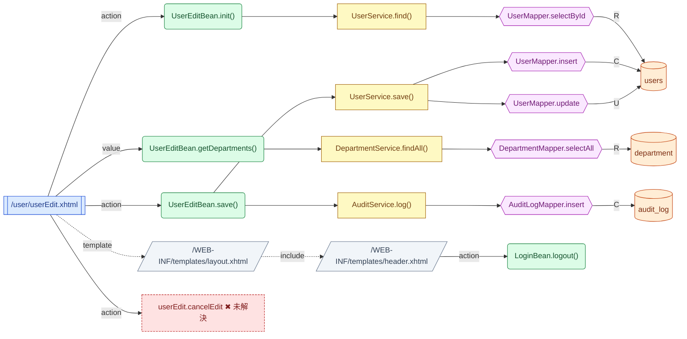

# 画面: /user/userEdit.xhtml

- ファイル: `src/main/webapp/user/userEdit.xhtml`
- テンプレート / インクルード:
  - template: `src/main/webapp/WEB-INF/templates/layout.xhtml`（`src/main/webapp/user/userEdit.xhtml` から）
  - include: `src/main/webapp/WEB-INF/templates/header.xhtml`（`src/main/webapp/WEB-INF/templates/layout.xhtml` から）
- 使用 Bean:
  - `userEdit` → com.example.app.web.UserEditBean（@ViewScoped）
  - `loginBean` → com.example.app.web.LoginBean（@SessionScoped）

## 呼び出しフロー

メソッド式と、下流（Service/Mapper）の呼び出しがあるプロパティのみ図示しています。全参照は下の表を参照してください。



## 呼び出しパス一覧

| 定義ファイル:行 | タグ@属性 | EL式 | Bean#メソッド | Service | Mapper#メソッド | SQL | テーブル | 備考 |
|---|---|---|---|---|---|---|---|---|
| src/main/webapp/user/userEdit.xhtml:9 | f:viewParam@value | `#{userEdit.id}` | UserEditBean#getId |  |  |  |  |  |
| src/main/webapp/user/userEdit.xhtml:10 | f:viewAction@action | `#{userEdit.init}` | UserEditBean#init | UserService#find | UserMapper#selectById | select | users |  |
| src/main/webapp/user/userEdit.xhtml:13 | h:inputText@value | `#{userEdit.user.name}` | UserEditBean#getUser |  |  |  |  |  |
| src/main/webapp/user/userEdit.xhtml:14 | h:inputText@value | `#{userEdit.user.email}` | UserEditBean#getUser |  |  |  |  |  |
| src/main/webapp/user/userEdit.xhtml:15 | h:selectOneMenu@value | `#{userEdit.user.departmentId}` | UserEditBean#getUser |  |  |  |  |  |
| src/main/webapp/user/userEdit.xhtml:16 | f:selectItems@value | `#{userEdit.departments}` | UserEditBean#getDepartments | DepartmentService#findAll | DepartmentMapper#selectAll | select | department |  |
| src/main/webapp/user/userEdit.xhtml:18 | h:commandButton@action | `#{userEdit.save}` | UserEditBean#save | UserService#save | UserMapper#insert | insert | users |  |
| src/main/webapp/user/userEdit.xhtml:18 | h:commandButton@action | `#{userEdit.save}` | UserEditBean#save | UserService#save | UserMapper#update | update | users |  |
| src/main/webapp/user/userEdit.xhtml:18 | h:commandButton@action | `#{userEdit.save}` | UserEditBean#save | AuditService#log | AuditLogMapper#insert | insert | audit_log |  |
| src/main/webapp/user/userEdit.xhtml:20 | h:commandButton@action | `#{userEdit.cancelEdit}` | UserEditBean#cancelEdit（未定義） |  |  |  |  | UserEditBean にメソッド 'cancelEdit' がありません |
| src/main/webapp/WEB-INF/templates/header.xhtml:4 | h:form@rendered | `#{loginBean.loggedIn}` | LoginBean#isLoggedIn |  |  |  |  |  |
| src/main/webapp/WEB-INF/templates/header.xhtml:5 | (テキスト) | `#{loginBean.userName}` | LoginBean#getUserName |  |  |  |  |  |
| src/main/webapp/WEB-INF/templates/header.xhtml:6 | h:commandLink@action | `#{loginBean.logout}` | LoginBean#logout |  |  |  |  |  |

## 使用 SQL

### UserMapper#selectById（select）

- 定義元: `src/main/resources/com/example/app/mapper/UserMapper.xml:21`
- テーブル: users

```sql
SELECT u.id, u.login_id, u.name, u.email, u.department_id FROM users u WHERE u.id = #{id}
```

### DepartmentMapper#selectAll（select）

- 定義元: `src/main/resources/com/example/app/mapper/DepartmentMapper.xml:4`
- テーブル: department

```sql
SELECT id, name FROM department ORDER BY id
```

### UserMapper#insert（insert）

- 定義元: `src/main/resources/com/example/app/mapper/UserMapper.xml:29`
- テーブル: users

```sql
INSERT INTO users (login_id, name, email, department_id) VALUES (#{loginId}, #{name}, #{email}, #{departmentId})
```

### UserMapper#update（update・動的SQL）

- 定義元: `src/main/resources/com/example/app/mapper/UserMapper.xml:34`
- テーブル: users

```sql
UPDATE users SET name = #{name}, email = #{email}, department_id = #{departmentId} WHERE id = #{id}
```

### AuditLogMapper#insert（insert）

- 定義元: `src/main/java/com/example/app/mapper/AuditLogMapper.java:10 @Insert`
- テーブル: audit_log

```sql
INSERT INTO audit_log (operator, action, target_id, created_at) VALUES (#{operator}, #{action}, #{targetId}, CURRENT_TIMESTAMP)
```

## 未解決・要確認

- **EL: メソッド未定義** src/main/webapp/user/userEdit.xhtml:20 `#{userEdit.cancelEdit}`: UserEditBean にメソッド 'cancelEdit' がありません
