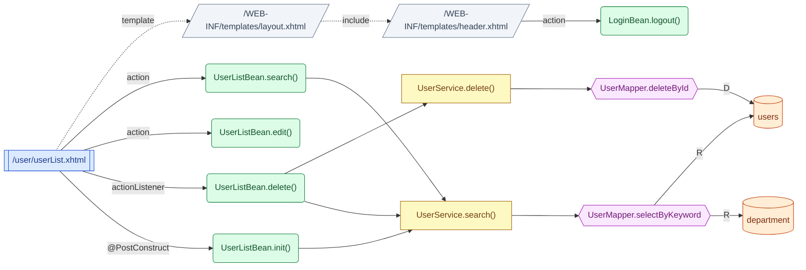

# 画面: /user/userList.xhtml

- ファイル: `src/main/webapp/user/userList.xhtml`
- テンプレート / インクルード:
  - template: `src/main/webapp/WEB-INF/templates/layout.xhtml`（`src/main/webapp/user/userList.xhtml` から）
  - include: `src/main/webapp/WEB-INF/templates/header.xhtml`（`src/main/webapp/WEB-INF/templates/layout.xhtml` から）
- 使用 Bean:
  - `userListBean` → com.example.app.web.UserListBean（@ViewScoped）
  - `loginBean` → com.example.app.web.LoginBean（@SessionScoped）

## 呼び出しフロー

メソッド式と、下流（Service/Mapper）の呼び出しがあるプロパティのみ図示しています。全参照は下の表を参照してください。



## 呼び出しパス一覧

| 定義ファイル:行 | タグ@属性 | EL式 | Bean#メソッド | Service | Mapper#メソッド | SQL | テーブル | 備考 |
|---|---|---|---|---|---|---|---|---|
| src/main/webapp/user/userList.xhtml:9 | h:inputText@value | `#{userListBean.keyword}` | UserListBean#getKeyword |  |  |  |  |  |
| src/main/webapp/user/userList.xhtml:10 | h:commandButton@action | `#{userListBean.search}` | UserListBean#search | UserService#search | UserMapper#selectByKeyword | select | users, department |  |
| src/main/webapp/user/userList.xhtml:13 | h:dataTable@value | `#{userListBean.users}` | UserListBean#getUsers |  |  |  |  |  |
| src/main/webapp/user/userList.xhtml:19 | h:commandLink@action | `#{userListBean.edit(u.id)}` | UserListBean#edit |  |  |  |  |  |
| src/main/webapp/user/userList.xhtml:20 | h:commandLink@actionListener | `#{userListBean.delete(u)}` | UserListBean#delete | UserService#delete | UserMapper#deleteById | delete | users |  |
| src/main/webapp/user/userList.xhtml:20 | h:commandLink@actionListener | `#{userListBean.delete(u)}` | UserListBean#delete | UserService#search | UserMapper#selectByKeyword | select | users, department |  |
| src/main/webapp/user/userList.xhtml:24 | h:outputText@value | `#{userListBean.users.size()}` | UserListBean#getUsers |  |  |  |  |  |
| src/main/webapp/user/userList.xhtml:24 | h:outputText@rendered | `#{not empty userListBean.users}` | UserListBean#getUsers |  |  |  |  |  |
| src/main/webapp/WEB-INF/templates/header.xhtml:4 | h:form@rendered | `#{loginBean.loggedIn}` | LoginBean#isLoggedIn |  |  |  |  |  |
| src/main/webapp/WEB-INF/templates/header.xhtml:5 | (テキスト) | `#{loginBean.userName}` | LoginBean#getUserName |  |  |  |  |  |
| src/main/webapp/WEB-INF/templates/header.xhtml:6 | h:commandLink@action | `#{loginBean.logout}` | LoginBean#logout |  |  |  |  |  |
| src/main/java/com/example/app/web/UserListBean.java:24 | @PostConstruct | `(@PostConstruct userListBean)` | UserListBean#init | UserService#search | UserMapper#selectByKeyword | select | users, department |  |

## 使用 SQL

### UserMapper#selectByKeyword（select・動的SQL）

- 定義元: `src/main/resources/com/example/app/mapper/UserMapper.xml:9`
- テーブル: users, department

```sql
SELECT u.id, u.login_id, u.name, u.email, u.department_id FROM users u LEFT OUTER JOIN department d ON d.id = u.department_id WHERE (u.name LIKE CONCAT('%', #{keyword}, '%') OR d.name LIKE CONCAT('%', #{keyword}, '%')) ORDER BY u.id
```

### UserMapper#deleteById（delete）

- 定義元: `src/main/resources/com/example/app/mapper/UserMapper.xml:44`
- テーブル: users

```sql
DELETE FROM users WHERE id = #{id}
```
